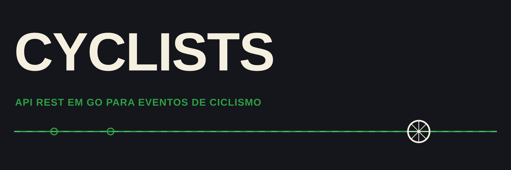

<h4 align="center">API REST em <a href="https://go.dev/" target="_blank">Go</a> para gestão de eventos de ciclismo.</h4>

<p align="center">
  
  <a href="https://github.com/matheusgb/cyclists/actions/workflows/ci.yml">
    
  </a>
  <a href="./LICENSE">
    
  </a>
</p>

<p align="center">
  <a href="#funcionalidades">Funcionalidades</a> •
  <a href="#arquitetura">Arquitetura</a> •
  <a href="#como-usar">Como usar</a> •
  <a href="#documentação">Documentação</a>
</p>

## Funcionalidades

* Login com JWT
* CRUD de usuários
* CRUD de eventos de ciclismo
* Inscrição de usuários em eventos
* Envio de e-mail de redefinição de senha via SendGrid
* Paginação
* Privilégios de administrador
* Endpoint de health check

## Arquitetura

Em camadas: controllers → services → repositories → GORM, com validação de
requisições, mocks por domínio e cobertura de testes unitários e e2e por
camada (`src/tests/`).

## Como usar

### Docker

```
cp src/config/config.example.json src/config/config.json
make up
```

A API sobe em `:3000` já com um Postgres configurado no `docker-compose.yml`.

### Local

Preencha o arquivo `config.json` com as credenciais do PostgreSQL, JWT e SendGrid.

Não é necessário alterar a chave `enviroment`.

Se tiver o [air](https://github.com/air-verse/air) instalado, rode o projeto com o comando na raiz:

```
air
```

Também é possível rodar com:

```
make run
```

Para rodar todos os testes:

```
make test
```

## Documentação

Com a API no ar, a documentação interativa (Swagger UI, gerada com [swaggo](https://github.com/swaggo/swag)) fica disponível em:

```
http://localhost:3000/docs/index.html
```

Após alterar rotas ou anotações, regenere os arquivos com:

```
make swag
```
